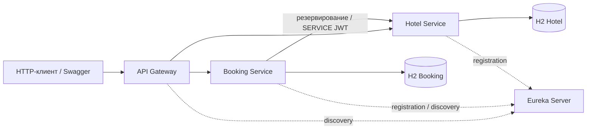

# Hotel Booking System

Hotel Booking System — учебная микросервисная система, которая проводит
пользователя через полный цикл бронирования: от регистрации и поиска свободного
номера до подтверждения, просмотра истории и отмены. С системой можно работать
через HTTP-клиент или Swagger UI; ниже приведён последовательный сценарий запуска
и демонстрации API.

Основная техническая задача проекта — согласовать работу двух сервисов с разными
базами данных. Booking хранит пользовательскую заявку, Hotel резервирует номер.
Они могут потерять связь, получить повторный запрос или столкнуться с конкуренцией
за один слот. Поэтому в центре реализации — локальные транзакции, идемпотентная
Saga, защита от пересечений и восстановление после неопределённого результата.

Проект построен на **Java 21, Spring Boot 3.5.16 и Spring Cloud 2025.0.0**.
JWT проверяется в Gateway и обоих бизнес-сервисах. Для хранения используется
отдельная H2 in-memory у каждого бизнес-сервиса.

## Навигация

- [Возможности](#возможности) · [Архитектура](#как-устроена-система) · [Жизненный цикл бронирования](#как-работает-бронирование).
- [Сборка](#требования-и-сборка) · [Ключи и demo-пароли](#ключи-и-пароли-demo) · [Запуск](#запуск).
- [Получение JWT](#получение-user-и-admin-jwt) · [Рекомендации и бронь](#рекомендации-и-бронирование) · [История и отмена](#история-статистика-и-отмена).
- [Карта API](#карта-публичного-api) · [Swagger](#swagger) · [Postman](#проверка-в-postman) · [Остановка demo](#остановка-demo).
- [Тесты](#тесты-и-стиль) · [Диагностика](#если-что-то-пошло-не-так) · [Ограничения](#границы-учебной-конфигурации) · [Документация](#документация-проекта).

## Возможности

| Кто работает с системой | Что доступно |
|---|---|
| Пользователь | Регистрация и вход, каталог отелей, свободные номера на выбранные даты, рекомендации, ручное бронирование и автоподбор |
| Владелец бронирования | Своя история с пагинацией, просмотр состояния и отмена; повторная отправка операции сохраняет её идентичность |
| Администратор | Управление отелями, номерами и пользователями, вывод номера из эксплуатации, статистика загрузки за период |

Например, пользователь может выбрать конкретный номер или попросить систему
подобрать наименее использованный среди свободных. Администратор видит, сколько
подтверждений и ночей приходится на номер, и может закрыть его для новых бронирований
на время ремонта. Существующая история при этом сохраняется.

## Как устроена система



У каждого приложения своя роль. Gateway принимает публичные запросы и проверяет
доступ. Eureka помогает находить адреса сервисов. Booking отвечает за пользователя
и процесс бронирования, а Hotel — за каталог и фактическую занятость номеров.
Общей БД между ними нет: состояние согласуется через REST и локальные транзакции.

| Приложение | Порт по умолчанию | Назначение |
|---|---:|---|
| [discovery-service](discovery-service/README.md) | 8761 | Eureka |
| [hotel-service](hotel-service/README.md) | 8082 | Отели, номера, занятость, рекомендации, статистика |
| [booking-service](booking-service/README.md) | 8083 | Пользователи, JWT, бронирования, Saga |
| [api-gateway](api-gateway/README.md) | 8080 | Публичные маршруты, JWT/роли, Swagger |

Вспомогательные модули: [request-context](request-context/README.md),
[api-support](api-support/README.md), [system-tests](system-tests/README.md).
[Архитектура](docs/architecture.md) · [ER и словарь БД](docs/data-model.md) ·
[ADR](docs/adr/README.md) · [Проверка готовности](docs/readiness.md).

В репозитории приложения и библиотеки разделены на Maven-модули:

```text
hotel-booking-system/
├── api-gateway/         — публичный вход и маршрутизация
├── discovery-service/   — реестр Eureka
├── booking-service/     — пользователи, бронирования и Saga
├── hotel-service/       — каталог, резервы и аналитика
├── request-context/     — корреляция HTTP и MDC
├── api-support/         — общий контракт ошибок
├── system-tests/        — системный стенд JUnit/Failsafe
├── docs/                — архитектура, ER, ADR и инструкции
├── .github/workflows/   — CI
└── pom.xml              — сборка Maven reactor
```

### Почему выбран этот стек

| Инструменты | Роль в проекте |
|---|---|
| Spring MVC, Spring Cloud Gateway и Eureka | REST API, маршрутизация и динамическое обнаружение сервисов |
| Spring Data JPA, Hibernate и H2 | Локальные транзакции, связи, ограничения уникальности и блокировки |
| Spring Security, JWT RS256 и BCrypt | Проверка подписи и ролей, методная защита и хранение хешей паролей |
| Resilience4j и HTTP timeout/retry | Ограничение обращений к недоступному Hotel и безопасное откладывание Saga |
| springdoc-openapi | Спецификации и ручная работа с API через Swagger |
| JUnit, MockMvc и Maven Failsafe | Проверки от контроллера до четырёх работающих JVM |
| Spotless и google-java-format | Единый стиль Java и проверка форматирования в сборке |

## Как работает бронирование

Рассмотрим запрос на номер с 1 по 3 января. Booking и Hotel должны согласовать
одну операцию, даже если клиент отправит её несколько раз.

1. Клиент передаёт `requestId`, даты и выбранный номер либо `autoSelect=true`.
   Booking сохраняет локальную запись **PENDING** и фиксирует транзакцию.
2. Hotel проверяет эксплуатационную доступность и пересечения дат под блокировкой
   номера. Успешное резервирование создаёт **HELD**.
3. Hotel подтверждает резерв и увеличивает `timesBooked` один раз. Booking
   сохраняет **CONFIRMED** и возвращает результат пользователю.
4. При отказе Booking запускает компенсацию. Маркер **RELEASED** защищает от
   запоздавшего reserve, а подтверждённое освобождение позволяет записать **CANCELLED**.
5. Если ответ потерян, Booking сверяет состояние Hotel. При неизвестном исходе
   операция остаётся сохранённой, а её завершением занимается планировщик.

Сетевые вызовы имеют таймауты и ограниченные повторы с backoff. Circuit Breaker
временно прекращает обращения при накоплении ошибок. Это позволяет сохранить
состояние операции и продолжить обработку после восстановления связи.

| Ответ на POST /api/bookings | Как его понимать |
|---|---|
| 200 / CONFIRMED | Бронирование подтверждено |
| 202 / PENDING | Итог ещё неизвестен; состояние доступно через GET по ID |
| 409 / BOOKING_CANCELLED | Операция завершилась отменой; её ID находится в fields.bookingId |
| 409 / IDEMPOTENCY_CONFLICT | Прежний requestId использован с другим владельцем или параметрами |

При двух конкурентных заявках на один номер пересекающийся слот получает одно
подтверждение. При повторе одного `requestId` сохраняется один `bookingId`.
Новый ключ нужен для новой операции; при выяснении результата уже отправленной
заявки используется её прежний ключ и GET по ID.

### Что означает свободный номер

`available=true` означает, что номер можно эксплуатировать. Для выбранных дат
он дополнительно должен не иметь пересечений с HELD/CONFIRMED. Интервалы
полуоткрытые: выезд 3 января позволяет следующий заезд 3 января.

Автоподбор стремится выравнивать число подтверждений. Условный пример для трёх
доступных и свободных на одни даты номеров:

| ID номера | timesBooked | Позиция в рекомендациях |
|---|---:|---:|
| 101 | 2 | 3 |
| 102 | 0 | 1 |
| 103 | 0 | 2 |

Сначала будет предложен 102: у него минимальный счётчик и меньший ID среди
равных кандидатов. Выбор повторно проверяется под блокировкой. При конкуренции
Hotel продолжает поиск по следующим кандидатам. Отмена сохраняет накопительный
`timesBooked`; загрузка по ночам рассчитывается отдельно за выбранный период.
Подробнее: [автоподбор](docs/room-selection.md), [Saga](docs/booking-saga.md).

## Требования и сборка

Установите полный **JDK 21** и Maven **3.9+**, добавьте их bin в PATH, задайте
JAVA_HOME на каталог JDK. Для ручного demo нужны Bash, OpenSSL, curl и jq.
Проверьте, что Maven использует тот же JDK, а javac установлен:

```sh
java -version
javac -version
mvn -version
git clone https://github.com/MalskyKirill/hotel-booking-system.git
cd hotel-booking-system
mvn -B -ntp -Psystem-tests -DskipTests package
```

Все Java-библиотеки и плагины загружает Maven из Maven Central; вручную копировать
JAR не нужно. Профиль system-tests включает repackage: четыре сервисных JAR
становятся исполняемыми. Обычный package без профиля этого не делает. Флаг
-DskipTests подходит для быстрого запуска; обязательный полный прогон приведён
ниже. Форматирование проверяется и при такой сборке.

Если среда требует HTTP-прокси, настройте Maven settings.xml и доверие к CA в
используемом JDK. Ошибка PKIX означает проблему доверия сертификатам; не отключайте
TLS-проверку. После успешного получения зависимостей возможен повтор с `mvn -o`.
Четыре JVM требуют отдельной памяти; приведённый demo ограничивает heap каждой
до 384 MiB, полный стенд дополнительно запускает Maven и тестовую JVM.

## Ключи и пароли demo

Откройте отдельный Bash и выполняйте следующие блоки **в одной сессии из корня
репозитория**. Порты 8761, 8080, 8082, 8083 должны быть свободны. Ключи создаются
в новом временном каталоге вне Git; существующие пары не перезаписываются.

```bash
set -euo pipefail
umask 077
HOTEL_RUN_DIR=$(mktemp -d "${TMPDIR:-/tmp}/hotel-demo.XXXXXX")
openssl genpkey -algorithm RSA -pkeyopt rsa_keygen_bits:2048 \
  -out "$HOTEL_RUN_DIR/private.pem" 2>"$HOTEL_RUN_DIR/keygen.log"
openssl pkey -in "$HOTEL_RUN_DIR/private.pem" -pubout -out "$HOTEL_RUN_DIR/public.pem"
export RSA_PUBLIC_KEY="file:$HOTEL_RUN_DIR/public.pem"
export NO_PROXY="${NO_PROXY:+$NO_PROXY,}localhost,127.0.0.1"
DEMO_ADMIN_PASSWORD=$(openssl rand -hex 16)
DEMO_USER_PASSWORD=$(openssl rand -hex 16)
HOTEL_PIDS=()
stop_hotel_demo() {
  if ((${#HOTEL_PIDS[@]} > 1)); then
    kill "${HOTEL_PIDS[@]:1}" 2>/dev/null || true
    wait "${HOTEL_PIDS[@]:1}" 2>/dev/null || true
  fi
  if ((${#HOTEL_PIDS[@]})); then
    kill "${HOTEL_PIDS[0]}" 2>/dev/null || true
    wait "${HOTEL_PIDS[0]}" 2>/dev/null || true
  fi
  HOTEL_PIDS=()
  rm -f "$HOTEL_RUN_DIR/private.pem" "$HOTEL_RUN_DIR/public.pem"
  unset USER_TOKEN ADMIN_TOKEN NEW_TOKEN USER_LOGIN ADMIN_LOGIN NEW_PASSWORD
  unset DEMO_ADMIN_PASSWORD DEMO_USER_PASSWORD RSA_PUBLIC_KEY
}
trap stop_hotel_demo EXIT
```

PUBLIC KEY — X.509, PRIVATE KEY — PKCS#8. Публичный ключ нужен Gateway, Booking и
Hotel; приватный передаётся только Booking. Пароли генерируются во время запуска
и не выводятся. Не включайте `set -x` при работе с JWT и паролями. В репозитории
нет готового приватного ключа; встроенные публичные файлы не заменяют новую пару.

| Настройка | Где используется |
|---|---|
| RSA_PUBLIC_KEY / rsa.public-key | Общий публичный ключ: Gateway, Booking, Hotel |
| RSA_PRIVATE_KEY / rsa.private-key | Только Booking; ниже задан CLI-путём к файлу |
| DEMO_ADMIN_PASSWORD, DEMO_USER_PASSWORD | Booking с demo, минимум 8 символов и максимум 72 UTF-8 байта |
| DEMO_ADMIN_USERNAME, DEMO_USER_USERNAME | Необязательные имена demo; по умолчанию demo-admin / demo-user |
| SPRING_PROFILES_ACTIVE / spring.profiles.active | demo — данные; dev — локальная H2 Console |
| SERVER_PORT / server.port | Порт конкретного приложения |
| eureka.client.serviceUrl.defaultZone | URL Eureka; стандартно http://localhost:8761/eureka/ |
| SPRING_DATASOURCE_URL / spring.datasource.url | Отдельный datasource каждого бизнес-сервиса |

В примерах CLI явно задаёт порты, БД и demo-имена, чтобы старые переменные
окружения не меняли сценарий. Параметры Saga и Circuit Breaker описаны в [Saga](docs/booking-saga.md).

## Запуск

Функция сохраняет PID только запущенных ею JVM, а логи — в HOTEL_RUN_DIR. Ожидание
проверяет и процессы, и HTTP; ошибка завершает demo и вызывает очистку.

```bash
start_service() {
  local service="$1"
  shift
  java -Xmx384m -jar "$service/target/$service-1.0-SNAPSHOT.jar" \
    --server.address=127.0.0.1 \
    --eureka.instance.prefer-ip-address=true --eureka.instance.ip-address=127.0.0.1 \
    --eureka.client.registry-fetch-interval-seconds=1 \
    "$@" >"$HOTEL_RUN_DIR/$service.log" 2>&1 &
  HOTEL_PIDS+=("$!")
}
wait_http() {
  local url="$1"
  for attempt in {1..120}; do
    for pid in "${HOTEL_PIDS[@]}"; do
      if ! kill -0 "$pid" 2>/dev/null; then
        echo "Приложение завершилось. Логи: $HOTEL_RUN_DIR" >&2
        return 1
      fi
    done
    if curl -fsS --max-time 2 "$url" >/dev/null 2>&1; then return 0; fi
    sleep 1
  done
  echo "HTTP не готов: $url. Логи: $HOTEL_RUN_DIR" >&2
  return 1
}
EUREKA_URL=http://localhost:8761/eureka/
start_service discovery-service --server.port=8761 --eureka.server.response-cache-update-interval-ms=1000
wait_http http://localhost:8761/
start_service hotel-service --server.port=8082 --spring.profiles.active=demo \
  --eureka.client.serviceUrl.defaultZone="$EUREKA_URL" \
  --spring.datasource.url=jdbc:h2:mem:hotel_readme \
  --spring.datasource.driver-class-name=org.h2.Driver \
  --spring.datasource.username=sa --spring.datasource.password= --spring.jpa.show-sql=false
wait_http http://localhost:8082/v3/api-docs
DEMO_ADMIN_PASSWORD="$DEMO_ADMIN_PASSWORD" DEMO_USER_PASSWORD="$DEMO_USER_PASSWORD" \
  start_service booking-service --server.port=8083 --spring.profiles.active=demo \
  --demo.admin.username=demo-admin --demo.user.username=demo-user \
  --rsa.private-key="file:$HOTEL_RUN_DIR/private.pem" \
  --eureka.client.serviceUrl.defaultZone="$EUREKA_URL" \
  --spring.datasource.url=jdbc:h2:mem:booking_readme \
  --spring.datasource.driver-class-name=org.h2.Driver \
  --spring.datasource.username=sa --spring.datasource.password= --spring.jpa.show-sql=false
wait_http http://localhost:8083/v3/api-docs
start_service api-gateway --server.port=8080 \
  --eureka.client.serviceUrl.defaultZone="$EUREKA_URL"
BASE_URL=http://localhost:8080
wait_http "$BASE_URL/v3/api-docs/booking"
wait_http "$BASE_URL/v3/api-docs/hotel"
```

Локальный demo регистрирует в Eureka тот же 127.0.0.1, на котором слушают JVM.
Это предотвращает обращение к адресу контейнера при loopback-привязке. Для
развёртывания на разных машинах задаются реальные доступные адреса экземпляров.
Для demo интервалы обновления реестра и серверного кэша сокращены до секунды;
Hotel и Booking запускаются с ожиданием HTTP-готовности перед следующей JVM.
При остановке клиенты завершаются до Eureka, чтобы успеть снять регистрацию.
Eureka распространяет адреса не мгновенно; ранний 503 допустим до готовности
маршрутов. Ответ 401 Gateway сам по себе не доказывает готовность backend,
поэтому ожидаются обе спецификации. Если запуск не удался, проверьте свободные
порты, JAVA_HOME, пути ключей, demo-пароли и журналы в HOTEL_RUN_DIR.

Профиль demo создаёт двух пользователей, два отеля и шесть номеров, два из них
недоступны для эксплуатации. Резервов изначально нет. Без demo обе бизнес-БД
пустые; обычная регистрация создаёт только USER. Первичного ADMIN для учебного
запуска создаёт demo-профиль. Подробности: [демонстрационные данные](docs/admin-demo.md).

## Получение USER и ADMIN JWT

JWT хранится в shell-переменных. expiresIn=3600, tokenType=Bearer. Login выполняется
обычным публичным API; пароли не передаются в URL.

```bash
USER_LOGIN=$(jq -n --arg password "$DEMO_USER_PASSWORD" \
  '{username:"demo-user",password:$password}' | \
  curl -fsS "$BASE_URL/api/auth/login" -H 'Content-Type: application/json' -d @-)
USER_TOKEN=$(printf '%s' "$USER_LOGIN" | jq -er '.accessToken')
ADMIN_LOGIN=$(jq -n --arg password "$DEMO_ADMIN_PASSWORD" \
  '{username:"demo-admin",password:$password}' | \
  curl -fsS "$BASE_URL/api/auth/login" -H 'Content-Type: application/json' -d @-)
ADMIN_TOKEN=$(printf '%s' "$ADMIN_LOGIN" | jq -er '.accessToken')
printf '%s' "$USER_LOGIN" | jq '{tokenType,expiresIn}'
printf '%s' "$ADMIN_LOGIN" | jq '{tokenType,expiresIn}'
```

Новая регистрация — отдельная операция, возвращает **201 с id/username/role=USER**.
JWT выдаётся последующим login, роль ADMIN регистрацией получить нельзя.

```bash
NEW_USERNAME="reader-$(openssl rand -hex 6)"
NEW_PASSWORD=$(openssl rand -hex 16)
jq -n --arg username "$NEW_USERNAME" --arg password "$NEW_PASSWORD" \
  '{username:$username,password:$password}' | \
  curl -fsS "$BASE_URL/api/auth/register" -H 'Content-Type: application/json' -d @- | jq .
NEW_TOKEN=$(jq -n --arg username "$NEW_USERNAME" --arg password "$NEW_PASSWORD" \
  '{username:$username,password:$password}' | \
  curl -fsS "$BASE_URL/api/auth/login" -H 'Content-Type: application/json' -d @- | jq -er '.accessToken')
```

## Рекомендации и бронирование

Даты ISO, интервал `[startDate,endDate)`. available означает эксплуатационное
состояние; свободность дополнительно учитывает пересечение HELD/CONFIRMED.
Выбираем ID из API, фиксированные ID demo не предполагаются.

```bash
HOTELS=$(curl -fsS "$BASE_URL/api/hotels" -H "Authorization: Bearer $USER_TOKEN")
printf '%s' "$HOTELS" | jq .
HOTEL_ID=$(printf '%s' "$HOTELS" | jq -er '.[0].id')
START_DATE=2027-01-01
END_DATE=2027-01-03
SEARCH_URL="$BASE_URL/api/rooms?hotelId=$HOTEL_ID&startDate=$START_DATE&endDate=$END_DATE"
RECOMMEND_URL="$BASE_URL/api/rooms/recommend?hotelId=$HOTEL_ID&startDate=$START_DATE&endDate=$END_DATE"
curl -fsS "$SEARCH_URL" -H "Authorization: Bearer $USER_TOKEN" | jq .
ROOM_ID=$(curl -fsS "$RECOMMEND_URL" -H "Authorization: Bearer $USER_TOKEN" | jq -er '.[0].id')
```

Ручное бронирование: на здоровом стеке ожидается 200/CONFIRMED. Повторяем **то же
тело** с прежним requestId и получаем прежний ID, без увеличения счётчика.

```bash
MANUAL_BODY=$(jq -n --argjson roomId "$ROOM_ID" --arg requestId "manual-$(openssl rand -hex 12)" \
  --arg startDate "$START_DATE" --arg endDate "$END_DATE" \
  '{roomId:$roomId,requestId:$requestId,startDate:$startDate,endDate:$endDate}')
MANUAL_RESULT=$(curl -fsS "$BASE_URL/api/bookings" -H "Authorization: Bearer $USER_TOKEN" \
  -H 'Content-Type: application/json' -H 'X-Correlation-Id: readme-manual' -d "$MANUAL_BODY")
printf '%s' "$MANUAL_RESULT" | jq .
BOOKING_ID=$(printf '%s' "$MANUAL_RESULT" | jq -er '.id')
curl -fsS "$BASE_URL/api/bookings" -H "Authorization: Bearer $USER_TOKEN" \
  -H 'Content-Type: application/json' -d "$MANUAL_BODY" | jq .
```

Ключевые поля успешного ответа выглядят так; ID в примере условные:

```json
{
  "id": 17,
  "roomId": 102,
  "startDate": "2027-01-01",
  "endDate": "2027-01-03",
  "status": "CONFIRMED",
  "cancellationRequested": false
}
```

`id` используется для чтения и отмены бронирования. `roomId` — выбранный номер
Hotel. Полный ответ также содержит `createdAt`. В PENDING при автоподборе roomId
может быть null, пока Hotel не сообщил результат выбора.

Автоподбор в том же отеле возьмёт второй доступный номер. roomId при
autoSelect=true игнорируется; сортировка — timesBooked ASC, id ASC.

```bash
AUTO_BODY=$(jq -n --argjson hotelId "$HOTEL_ID" --arg requestId "auto-$(openssl rand -hex 12)" \
  --arg startDate "$START_DATE" --arg endDate "$END_DATE" \
  '{autoSelect:true,roomId:999999,hotelId:$hotelId,requestId:$requestId,startDate:$startDate,endDate:$endDate}')
AUTO_RESULT=$(curl -fsS "$BASE_URL/api/bookings" -H "Authorization: Bearer $USER_TOKEN" \
  -H 'Content-Type: application/json' -d "$AUTO_BODY")
printf '%s' "$AUTO_RESULT" | jq .
AUTO_ID=$(printf '%s' "$AUTO_RESULT" | jq -er '.id')
```

При неопределённом результате POST возвращает 202/PENDING. Перед продолжением
проверьте GET по ID до терминального статуса; 409 BOOKING_CANCELLED содержит ID
в fields.bookingId. Новая попытка после отмены требует нового requestId.
Повтор с изменёнными параметрами/владельцем даёт 409 IDEMPOTENCY_CONFLICT.
[Подробный протокол Saga](docs/booking-saga.md).

## История, статистика и отмена

История имеет нумерацию страниц с нуля, size от 1 до 100. Чужая бронь возвращает
404 даже ADMIN. Статистика требует ADMIN; USER получает 403.

```bash
curl -fsS "$BASE_URL/api/bookings?page=0&size=20" -H "Authorization: Bearer $USER_TOKEN" | jq .
curl -fsS "$BASE_URL/api/bookings/$BOOKING_ID" -H "Authorization: Bearer $USER_TOKEN" | jq .
curl -fsS "$BASE_URL/api/admin/rooms/statistics?hotelId=$HOTEL_ID&startDate=$START_DATE&endDate=$END_DATE" \
  -H "Authorization: Bearer $ADMIN_TOKEN" | jq .
curl -fsS -X DELETE "$BASE_URL/api/bookings/$BOOKING_ID" -H "Authorization: Bearer $USER_TOKEN" | jq .
curl -fsS -X DELETE "$BASE_URL/api/bookings/$AUTO_ID" -H "Authorization: Bearer $USER_TOKEN" | jq .
curl -fsS -X DELETE "$BASE_URL/api/bookings/$BOOKING_ID" -H "Authorization: Bearer $USER_TOKEN" | jq .
curl -fsS "$SEARCH_URL" -H "Authorization: Bearer $USER_TOKEN" | jq .
```

На свежих demo-БД после двух подтверждений в выбранном отеле заняты оба
эксплуатируемых номера. В статистике перед отменой у каждого из них будет
`confirmedReservations=1`, `confirmedNights=2` и загрузка за эти две ночи 100%.
Третий номер остаётся недоступным. После завершения обеих отмен поиск снова
покажет два свободных номера, а их `timesBooked` останется равным 1.

DELETE возвращает 200/CANCELLED либо 202 с cancellationRequested=true. Во втором
случае проверяйте GET до CANCELLED и сброса флага: слот ещё может быть занят.
Повтор отмены безопасен, timesBooked не уменьшается.
[История и отмена](docs/booking-history-cancellation.md), [статистика](docs/admin-demo.md).

## Карта публичного API

| Маршруты | Операции и доступ |
|---|---|
| POST /api/auth/register, /api/auth/login | Регистрация USER и вход, без JWT |
| POST/GET /api/bookings; GET/DELETE /api/bookings/{id} | Создание, своя история, чтение и отмена; USER/ADMIN |
| GET /api/hotels и /api/hotels/{id} | Каталог; USER/ADMIN |
| POST /api/hotels; PUT/DELETE /api/hotels/{id} | Отели; ADMIN |
| GET /api/rooms, /api/rooms/recommend | Свободные номера и рекомендации с обязательными датами; USER/ADMIN |
| POST /api/rooms | Создание номера; ADMIN |
| GET/POST /api/admin/rooms; GET/PUT/DELETE /api/admin/rooms/{id} | Номера; ADMIN |
| GET /api/admin/rooms/statistics | Загрузка за период; ADMIN |
| GET/POST /api/admin/users; GET/PATCH/DELETE /api/admin/users/{id} | Пользователи; ADMIN |

Точные тела, фильтры и ограничения удаления: [администрирование](docs/admin-demo.md)
и [Swagger](docs/openapi.md). Внутренние маршруты и SERVICE JWT клиентскому API
не предназначены. Ошибки имеют [единый контракт ApiError](docs/api-errors-security.md).

## Swagger

- http://localhost:8080/swagger-ui.html — выбор Booking Service / Hotel Service.
- http://localhost:8080/v3/api-docs/booking и http://localhost:8080/v3/api-docs/hotel — спецификации.
- http://localhost:8761/ — реестр Eureka.

В Authorize вставляйте значение JWT без префикса Bearer. Бизнес-операции остаются
защищёнными, документация доступна без JWT. H2 Console по умолчанию выключена;
локальный dev-профиль и ограничения доступа описаны в [безопасности](docs/api-errors-security.md).

## Остановка demo

В исходной сессии Bash выполните:

```bash
stop_hotel_demo
trap - EXIT
```

Процессы остановлены, временные ключи удалены, логи остаются в HOTEL_RUN_DIR.
H2 теряет данные после остановки JVM. Восстановление после потери самой БД,
распределённый отзыв JWT после смены роли/пароля, горизонтальный HA и production
SLA не реализованы. Подробнее о решениях: [ADR](docs/adr/README.md),
о диагностике — [корреляция и ECS](docs/observability.md).

## Проверка в Postman

Для готового локального стенда открой проект в IDEA с JDK 21 и запусти общую
конфигурацию **Hotel Booking - Postman**. Она собирает проект, генерирует ключи и
demo-пароли, запускает четыре сервиса в нужном порядке и дожидается маршрутов
Gateway. При установленном Maven можно выполнить ту же команду из корня:

```sh
mvn -N -Ppostman-demo exec:exec
```

После сообщения **ГОТОВО** импортируй в Postman коллекцию из `postman/` и
заполненное окружение `.local/postman/HotelBooking.ready.postman_environment.json`.
Выбери **Hotel Booking — Local** и запусти всю коллекцию через **Run**, одна
итерация. Вводить пароли вручную не нужно. Подробная инструкция для Mac и IDEA,
включая выбор JDK и импорт скрытой папки, — в [postman/README.md](postman/README.md).

Окно запуска оставь открытым. **Stop** в IDEA или **Ctrl+C** в терминале останавливает
собственные сервисы и удаляет временные ключи. Пароли и окружение остаются локально
в игнорируемой Git папке `.local/postman/`; повторный запуск использует те же пароли.
Перед запуском останови ранее запущенные вручную приложения на портах
8761, 8080, 8082, 8083. Стенд проверяет свободные порты и не завершает чужие процессы.

Сценарий сам получает JWT, создаёт собственные тестовые данные, проверяет роли,
CRUD, ручную бронь, автоподбор, конфликты, историю, статистику и отмену.
Подтверждение и отмена при ответе 202 ожидаются до 90 секунд. В конце свои
брони отменяются; защищённая от удаления история остаётся в базе. Подробнее о
подготовке, повторном запуске и ожидаемых HTTP-ошибках — в инструкции коллекции.

## Тесты и стиль

Остановите ручной demo перед clean-сборкой, затем из корня выполните:

```sh
# JUnit/MockMvc и проверки форматирования
mvn -B -ntp clean verify
# Исполняемые JAR и полный системный прогон
mvn -B -ntp -Psystem-tests clean verify
# Если стандартные тестовые порты 19080–19084 заняты
mvn -B -ntp -Psystem-tests -Dsystem.base-port=20080 verify
# Применить стиль, включая системный модуль
mvn -B -ntp -Psystem-tests spotless:apply
```

Системный стенд сам создаёт RSA-ключи, отдельные H2, запускает четыре JVM и
останавливает их. Отчёты: */target/surefire-reports и
system-tests/target/failsafe-reports; логи: system-tests/target/stack-logs.
[Все сценарии и CI](docs/system-verification.md), [правила стиля](docs/code-style.md).

### Что именно подтверждают проверки

- **Контроллеры и безопасность:** регистрация и вход, валидация, 401/403,
  ограничения владельца и доступность OpenAPI.
- **Работа с данными:** пересечения дат, уникальность requestId/bookingId,
  конкурентное резервирование и однократное увеличение счётчика.
- **Устойчивость Saga:** потерянные ответы reserve/confirm/cancel, реальные
  таймауты, поздние запросы, пустой discovery и фоновое завершение операции.
- **Сквозная интеграция:** Gateway и Eureka, работающие бизнес-сервисы,
  переходы Circuit Breaker и единый traceId в HTTP и ECS-логах.
- **Повторные конкурентные серии:** три серии по 32 автоподбора, сверка
  резервов и статистики, повторная отправка ключей и освобождение после отмены.

Контрольный прогон от 2 ноября 2026 года: **309 обычных тестов и 20 системных**,
без ошибок и пропусков. В конкурентных сериях получены 96 подтверждений;
все 32 доступных номера использованы по три раза, недоступный номер исключён.
Результаты подтверждены [GitHub Actions](https://github.com/MalskyKirill/hotel-booking-system/actions/runs/41436353760)
и [проверкой в чистом checkout](docs/readiness.md). Область этих проверок —
один экземпляр каждого сервиса.

## Если что-то пошло не так

Начните с логов в `HOTEL_RUN_DIR`. Имя файла соответствует приложению:
`booking-service.log`, `hotel-service.log`, `api-gateway.log` или
`discovery-service.log`. Для запроса с X-Correlation-Id ищите тот же traceId
в журналах; `bookingId` связывает последующие фоновые попытки.

| Симптом | Что проверить |
|---|---|
| Maven сообщает `release version 21 not supported` | Версию JDK в `mvn -version`, JAVA_HOME и наличие javac |
| JAR не запускается как приложение | Сборку с профилем system-tests, который включает repackage |
| Не найден RSA-ключ или подпись JWT отклоняется | Абсолютный file:-путь; Gateway и Hotel должны использовать публичный ключ пары, которой подписывает Booking |
| Demo завершается при старте | Пароли demo, свободные порты и первый запуск из новой H2; при существующем demo-имени его роль должна совпадать |
| Gateway возвращает 503 после запуска | Готовность обеих спецификаций, регистрацию в Eureka и соответствие опубликованного адреса server.address |
| API возвращает 401 | Наличие JWT, срок действия и результат повторного login |
| Административный запрос возвращает 403 | Использование ADMIN_TOKEN; публичная регистрация создаёт USER |
| Получен 202 | Состояние через GET по ID; намерение операции сохранено, результат ещё выясняется |
| Получен IDEMPOTENCY_CONFLICT | Совпадение владельца и параметров с исходным requestId; новый ключ используется для новой операции |
| После перезапуска исчезли данные | H2 in-memory создаёт новую БД для новой JVM |
| Maven сообщает PKIX | Настройки прокси и доверие к CA в используемом JDK; TLS-проверка должна оставаться включённой |

Если бронирование осталось PENDING, сохраните его ID и проверьте доступность
Hotel и состояние Circuit Breaker в логах Booking. Планировщик продолжает
попытки. После 202 у отмены ориентируйтесь на CANCELLED и сброс
`cancellationRequested`, прежде чем считать номер освобождённым.

## Границы учебной конфигурации

H2 позволяет быстро получить независимые БД без внешней установки. Данные живут
в памяти JVM: восстановление Saga работает при сохранности обеих БД. Для
долговременной эксплуатации потребуются постоянное хранилище и миграции.

Автоподбор балансирует количество подтверждений. Одна ограниченная попытка
может не увидеть номер, освободившийся позади курсора. Накопительный счётчик
сохраняется после отмены, а процент загрузки считается по ночам за период.

JWT действует до истечения срока; смена роли или пароля не отзывает его
немедленно в Gateway/Hotel. Локальный demo использует HTTP и доверенную Eureka.
Проверки конкурентности описывают заданные сценарии одного экземпляра каждого
сервиса. Настройки TLS/mTLS, распределённый отзыв, HA и production SLA требуют
отдельной реализации и проверки.

## Документация проекта

README даёт маршрут от знакомства с системой до работающего demo. Подробности
контрактов и решений вынесены в тематические документы:

| Тема | Где читать |
|---|---|
| Устройство приложений и границы ответственности | [Архитектура](docs/architecture.md) |
| Таблицы, поля, индексы и ограничения | [ER и словарь БД](docs/data-model.md) |
| Причины принятых решений и неоднозначности ТЗ | [ADR](docs/adr/README.md) |
| Состояния, компенсация, retry и Circuit Breaker | [Saga](docs/booking-saga.md) |
| Свободность, рекомендации и конкурентный выбор | [Автоподбор](docs/room-selection.md) |
| История, чтение и отмена | [Личные бронирования](docs/booking-history-cancellation.md) |
| CRUD, аналитика и начальные данные | [Администрирование и demo](docs/admin-demo.md) |
| JWT, роли и формат ошибок | [Безопасность и ApiError](docs/api-errors-security.md) |
| Спецификации и ручные запросы | [Swagger/OpenAPI](docs/openapi.md) |
| Поиск связанных событий | [Корреляция и ECS](docs/observability.md) |
| Стенд, сценарии, отчёты и CI | [Системные проверки](docs/system-verification.md) |
| Стиль кода | [Форматирование](docs/code-style.md) |
| Сопоставление с критериями и результаты запуска | [Матрица готовности](docs/readiness.md) |
