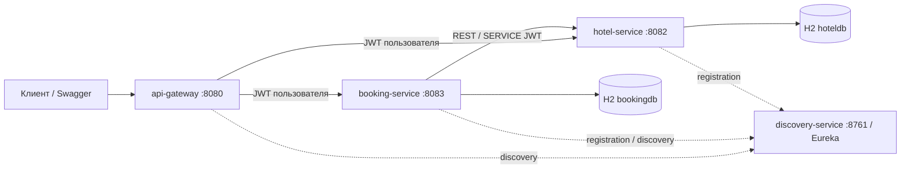

# Архитектура системы

Четыре самостоятельных приложения на Java 21, Spring Boot 3.5.16 и Spring Cloud
2025.0.0. Gateway использует Spring Cloud Gateway Server Web MVC. Данные разделены
между двумя H2 in-memory; Gateway и Eureka бизнес-БД не имеют.

## Границы ответственности

| Приложение | Ответственность | Данные |
|---|---|---|
| api-gateway | Публичные маршруты, JWT/роли до проксирования, Swagger, корреляция | Нет бизнес-БД |
| discovery-service | Eureka: регистрация и обнаружение адресов экземпляров | Реестр сервисов в памяти |
| booking-service | Пользователи, выпуск JWT, история и отмена бронирований, координатор Saga | users, booking |
| hotel-service | Каталог, занятость, рекомендации, атомарное резервирование, статистика | hotels, rooms, room_reservations, auto_reservation_operation |

В бизнес-сервисах выделены controller → service → repository → entity; DTO
содержат контракт и Bean Validation. Транзакционные операции Saga вынесены в
отдельные Spring-бины, поэтому REQUIRES_NEW проходит через proxy. Сетевые вызовы
выполняются вне транзакций БД. Репозитории предоставляют локальные FK, уникальность
и блокировки; согласование между БД выполняет протокол REST.

## Вспомогательные Maven-модули

| Модуль | Назначение |
|---|---|
| request-context | Общая библиотека servlet-корреляции, MDC traceId и исходящего RestClient interceptor |
| api-support | Общая библиотека ApiError, /error и базовых MVC/security-обработчиков |
| system-tests | JUnit/Failsafe-стенд профиля system-tests: четыре JVM, HTTP-прокси сбоев, отдельные H2 и временные ключи |

Библиотеки не запускаются как приложения. Доменные ошибки остаются в сервисах;
Gateway расширяет общий обработчик для обёрнутых транспортных ошибок. Тестовый
HTTP-прокси не является production-компонентом и не участвует в обычном запуске.

## Безопасность и маршруты

Gateway маршрутизирует /api/auth/**, /api/bookings/** и /api/admin/users/** в
Booking; /api/hotels/**, /api/rooms/** и /api/admin/rooms/** — в Hotel. Адреса
разрешаются через lb:// и Eureka. Gateway и оба бизнес-сервиса самостоятельно
проверяют подпись JWT, issuer и время. USER/ADMIN ограничиваются по маршрутам;
административные сервисы дополнительно защищены @PreAuthorize.

Booking → Hotel использует отдельный SERVICE JWT с aud=hotel-service,
sub=booking-service. /internal/** отсутствует среди маршрутов Gateway. Swagger и
register/login публичны; /actuator/** Gateway требует ADMIN. У Eureka нет
пользовательского REST API и собственной проверки бизнес-JWT. Сервисный discovery
в учебном стенде требует доверенной локальной сети.

## Бронирование и согласованность

1. Booking фиксирует PENDING с владельцем, requestId и параметрами.
2. Hotel проверяет available и пересечение дат под блокировкой номера и сохраняет
   HELD. При автоподборе выбирает номер по timesBooked ASC, id ASC.
3. Hotel подтверждает резерв и однократно увеличивает timesBooked.
4. Booking фиксирует CONFIRMED. При отказе или неизвестном результате сохраняет
   намерение компенсации и сверяет состояние Hotel.
5. Неизвестный итог остаётся PENDING/202. Планировщик завершает операцию после
   восстановления связи. Отмена подтверждённой брони сначала сохраняет намерение.

Timeout и ограниченный retry с backoff обёрнуты Circuit Breaker. RELEASED-маркеры
не допускают поздний reserve после компенсации. Общая транзакция и XA не
используются. Подробности: [Saga](booking-saga.md),
[история и отмена](booking-history-cancellation.md), [выбор номера](room-selection.md).

## Данные и диагностика

[ER, поля и ограничения](data-model.md), [безопасность и ошибки](api-errors-security.md),
[корреляция и ECS](observability.md), [Swagger](openapi.md),
[системные проверки](system-verification.md).

H2 in-memory и реестр Eureka теряют данные при остановке процесса. Восстановление
Saga требует сохранности обеих БД. Учебная конфигурация не включает постоянное
хранилище, распределённый отзыв JWT, production TLS, HA и доказанный SLA.

Обоснования неоднозначностей ТЗ и последствия решений: [ADR](adr/README.md).
