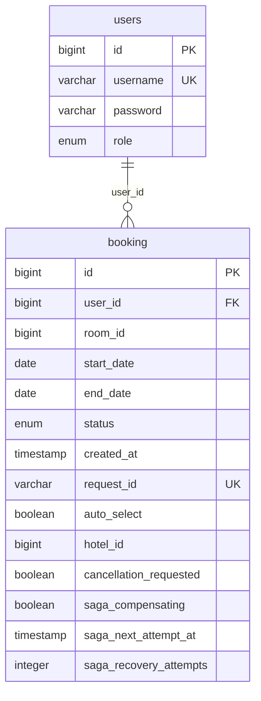
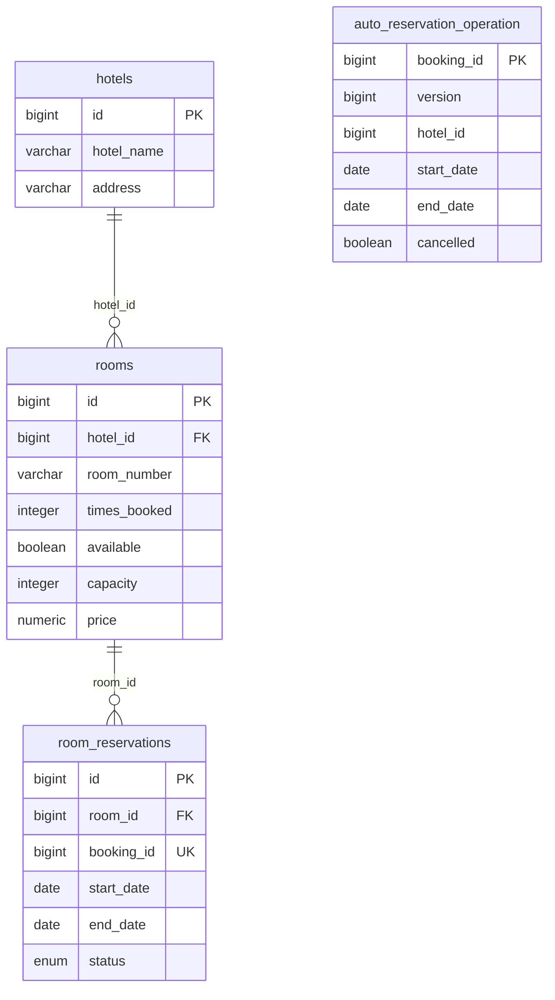

# Фактическая схема данных

Источники: [сущности Booking](../booking-service/src/main/java/ru/mephi/model) и
[сущности Hotel](../hotel-service/src/main/java/ru/mephi/model). Hibernate создаёт
схему при старте (ddl-auto=create-drop). Неявные имена переводятся в snake_case;
H2 показывает некавыченные имена в верхнем регистре. Здесь используется нижний.
Словарь сверен с JDBC-метаданными H2 2.3.232 / Hibernate 6.6 из текущей сборки.
Это описание учебной схемы, не набор миграций.

## Booking H2

| Поля | Фактический тип H2 / ограничения | Назначение |
|---|---|---|
| users.id | bigint PK, identity, NOT NULL | ID пользователя |
| users.username | varchar(255), NOT NULL, UNIQUE | Логин, sub JWT; DTO ограничивает 100 символами |
| users.password | varchar(255), NOT NULL | BCrypt-хеш |
| users.role | enum('ADMIN','USER'), NOT NULL | Роль |
| booking.id | bigint PK, identity, NOT NULL | Общий ID операции Saga |
| booking.user_id | bigint NOT NULL, FK users.id | Владелец, LAZY ManyToOne |
| booking.room_id | bigint NULL | ID номера Hotel, может быть неизвестен до автоподбора |
| booking.start_date / end_date | date NOT NULL | Полуоткрытый интервал |
| booking.status | enum('CANCELLED','CONFIRMED','PENDING'), NOT NULL | Локальное состояние |
| booking.created_at | timestamp(6) with time zone NOT NULL | Instant, @CreationTimestamp |
| booking.request_id | varchar(255), NOT NULL, UNIQUE | Глобальный ключ идемпотентности |
| booking.auto_select | boolean NOT NULL | Режим выбора |
| booking.hotel_id | bigint NULL | Фильтр автоподбора; логический ID |
| booking.cancellation_requested | boolean NOT NULL | Намерение пользовательской отмены |
| booking.saga_compensating | boolean NOT NULL | Намерение компенсации |
| booking.saga_next_attempt_at | timestamp(6) with time zone NOT NULL | Срок следующей попытки |
| booking.saga_recovery_attempts | integer NOT NULL | Счётчик восстановления |

Индекс idx_booking_saga_due: (status, saga_next_attempt_at, id).
PK и UNIQUE(username)/UNIQUE(request_id) обеспечиваются уникальными индексами;
H2 также создаёт индекс локального FK user_id. Имена автоматически созданных
индексов/ограничений не являются частью API.

requestId уникален для всех пользователей. При повторе приложение сверяет
владельца, даты, режим и применимые roomId/hotelId; несовпадение даёт 409.
Локальные изменения Booking выполняются под PESSIMISTIC_WRITE. Пользователь с
любой историей бронирований не удаляется, последний ADMIN не удаляется и не
понижается; это правила сервисов, а не каскадное удаление в БД.

## Hotel H2

| Поля | Фактический тип H2 / ограничения | Назначение |
|---|---|---|
| hotels.id | bigint PK, identity, NOT NULL | Отель |
| hotels.hotel_name / address | varchar(255) NOT NULL | Название и адрес |
| rooms.id | bigint PK, identity, NOT NULL | Номер |
| rooms.hotel_id | bigint NOT NULL, FK hotels.id | LAZY ManyToOne |
| rooms.room_number | varchar(255) NOT NULL | Номер внутри отеля |
| rooms.times_booked | integer NOT NULL | Накопительное число подтверждений |
| rooms.available | boolean NOT NULL | Операционная доступность |
| rooms.capacity | integer NOT NULL | Вместимость |
| rooms.price | numeric(10,2) NOT NULL | Цена |
| room_reservations.id | bigint PK, identity, NOT NULL | Локальный резерв |
| room_reservations.room_id | bigint NOT NULL, FK rooms.id | LAZY ManyToOne |
| room_reservations.booking_id | bigint NOT NULL UNIQUE | Логический ID Booking |
| room_reservations.start_date / end_date | date NOT NULL | Интервал |
| room_reservations.status | enum('CONFIRMED','HELD','RELEASED'), NOT NULL | Состояние резерва |
| auto_reservation_operation.booking_id | bigint PK NOT NULL, без identity | Назначается из Booking |
| auto_reservation_operation.version | bigint NULL, @Version | JPA назначает/проверяет версию; SQL NOT NULL не задан |
| auto_reservation_operation.hotel_id | bigint NULL | Исходный фильтр; без FK |
| auto_reservation_operation.start_date / end_date | date NOT NULL | Исходные даты |
| auto_reservation_operation.cancelled | boolean NOT NULL | Терминальный маркер отмены до выбора номера |

Ограничения и индексы:

- uq_rooms_hotel_number: UNIQUE(hotel_id, room_number).
- UNIQUE(room_reservations.booking_id): одна запись на Booking. В JPA одновременно
  заданы @Column(unique=true) и @UniqueConstraint с именем uq_reservations_booking_id;
  Hibernate объединяет одинаковые ограничения. Техническое имя в H2 может быть
  сгенерированным; гарантия — уникальность booking_id.
- idx_reservations_room_dates: (room_id, start_date, end_date, status).
- PK и локальные FK также имеют автоматически созданные индексы H2.
- @Enumerated(STRING) на текущем H2 отображается в native ENUM. Объявленный для
  статуса резерва length=20 не превращает фактическую колонку в varchar(20).

## Границы данных и инварианты

Между двумя H2 нет FK: booking.room_id/hotel_id и room_reservations.booking_id —
обычные ID REST-протокола. auto_reservation_operation.hotel_id тоже не является FK:
это неизменяемый исходный фильтр. Операция может существовать без резерва, например
после отмены до выбора номера. Межсервисных JPA-связей и общей БД нет.

SQL exclusion constraint на даты не используется. Под блокировкой строки rooms
сервис проверяет `existing.start_date < requested.end_date AND existing.end_date >
requested.start_date` для HELD/CONFIRMED и записывает резерв в той же транзакции.
RELEASED даты не занимает, но запрещает позднее резервирование для того же bookingId.
Проверки диапазонов дат, положительных значений и правила переходов — в приложении.

available=false запрещает новые резервы, не отменяет старые. Подтверждение
увеличивает times_booked ровно один раз; отмена не уменьшает счётчик. Отель с
номерами и номер с любой историей не удаляются. Поиск по свободности выполняется
на локальных room_reservations; статистика считает только пересечение с периодом.

## Соответствие минимальной модели ТЗ

| Формулировка ТЗ | Реализация |
|---|---|
| bookings | booking, сохранённое JPA-имя |
| hotels.name | hotels.hotel_name, Java-свойство name |
| rooms.number | rooms.room_number, Java-свойство roomNumber |
| Занятость по бронированиям | Локальная проекция room_reservations с bookingId вместо обращения к чужой БД |
| Дополнительные поля | Цена, вместимость, requestId, режим, намерения и состояние восстановления Saga |

Эти различия сохраняют границы сервисов и совместимость. Схема и данные теряются
при остановке JVM; миграции, архивирование истории и восстановление после потери
БД в учебной конфигурации не реализованы. См. [архитектуру](architecture.md).

Решение о владении данными и SQL-именах: [ADR 001](adr/001-data-boundaries.md).
